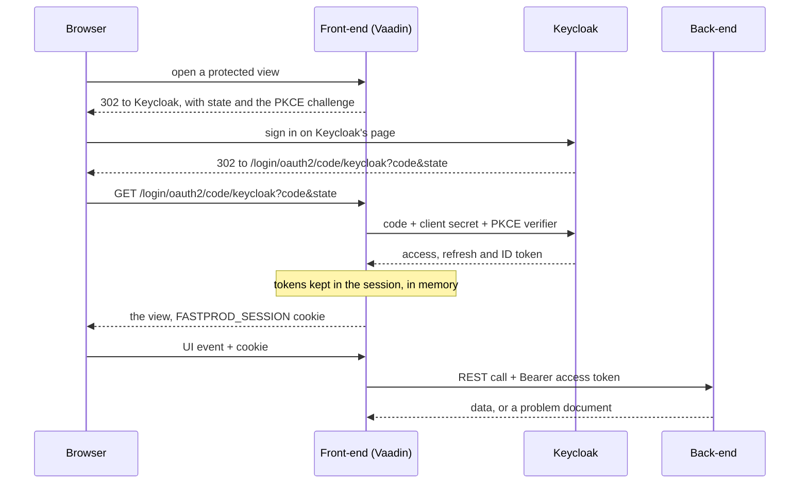

# Authentication

The application never handles a credential. Keycloak (realm `fastprod`) owns every page that touches one: sign-up,
sign-in, email verification, password reset, two-factor authentication and acceptance of the terms of use. The Vaadin
front-end is a BFF: it signs the user in, keeps the tokens in its server-side session and gives the browser only a
session cookie.

## Signing in

1. An anonymous user who opens a protected view, or chooses to sign in, goes to `/oauth2/authorization/keycloak`.
   `LocalizedAuthorizationRequestResolver` builds the authorization request with PKCE, passes the language picked in the
   application (`pl` unless `en` was chosen), and adds `prompt=create` for the sign-up button.
2. Keycloak returns to `/login/oauth2/code/keycloak`. Spring Security exchanges the code, using the confidential client
   `fastprod-frontend` and its secret, and keeps the tokens in the HTTP session.
3. `KeycloakOidcUserService` takes the realm roles from the access token, so Vaadin's `@RolesAllowed` and the menu see
   `ADMIN`, `MANAGER`, `EMPLOYEE` and `USER` as Keycloak grants them.

The browser holds only the `FASTPROD_SESSION` cookie: `HttpOnly`, `SameSite=Lax`, `Secure` outside the local profile.
Vaadin protects every request against CSRF on its own.

## Account actions

The profile view changes the password and turns the second factor on and off on Keycloak's own pages, so no password
and no TOTP secret passes through the application. `KeycloakAccount` reads the caller's OTP credential from Keycloak's
account API (`/realms/fastprod/account/credentials`) with the caller's own access token, which carries the `account`
audience and the `manage-account` role every account gets, so the application needs no right to read anyone else's
credentials; when Keycloak cannot be asked, the view offers neither. `KeycloakPages` sends the signed-in browser to
`/oauth2/authorization/keycloak?kc_action=…`, and `LocalizedAuthorizationRequestResolver` passes `kc_action` on to
Keycloak when it names one of `KeycloakPages.AccountAction`, `UPDATE_PASSWORD` or `CONFIGURE_TOTP`, or is
`delete_credential:<id>` with a UUID, and drops any other value. Keycloak shows only that page, asks to confirm a
removal and removes a credential only when it is the person's own, then returns through the usual sign-in.

## Calls to the back-end

The front-end calls the back-end with `Authorization: Bearer` and the session's access token (`AuthTokenProvider`,
used by `BaseHttpService`). The back-end is a stateless OAuth2 resource server: it verifies the signature against
Keycloak's published keys, the issuer, the expiry and the audience (`fastprod-api`), and takes the roles from
`realm_access.roles`. It creates no session, so every call is authorized by the token alone and any instance can serve
it.

## The session and refreshing

The session lives in the front-end's memory, and its access token is refreshed once per refresh token: [Token
refresh](../fastprod-frontend/docs/mechanisms/token-refresh.md).

## Signing out

Signing out ends the local session and sends the browser to Keycloak's end-session endpoint, which ends the Keycloak
session and returns to the application's home page.

## The sign-in pages

Keycloak draws the sign-in, sign-up, password reset and second-factor pages, and the mails it sends, with the theme in
[`keycloak/themes/fastprod`](../keycloak/themes/fastprod), so they look like the front-end:

| Part                      | Holds                                                                                              |
|---------------------------|----------------------------------------------------------------------------------------------------|
| `login/theme.properties`  | extends `keycloak.v2`, whose templates draw every page, and names the legal pages                  |
| `login/template.ftl`      | the page frame: a top bar with the name and the menus, a footer with the legal pages               |
| `login/resources`         | `css/app.css`, the colors, type and card on PatternFly; `js/language.js`, the language handed back |
| `login/messages`          | the texts of the bar and the footer, in Polish and English                                         |
| `email/html/template.ftl` | the frame of every mail; its texts stay Keycloak's own                                             |

The pages are light only, as the app is: `darkMode=false` in `theme.properties` turns off Keycloak's dark mode, and the
theme menu with it.

The language goes both ways. The sign-in page opens in the application's language, sent as `ui_locales`; Keycloak shows
a signed-in person their account's language instead, so before an account action the profile view stores the
application's language on the account, with the person's own token, through Keycloak's account API. A language chosen in
Keycloak's own menu goes back to the application, as the sign-in returns to an address that carries nothing else:
`language.js` leaves it in the cookie `ui_locale_fastprod`, under the domain Keycloak shares with the application, the
parent of Keycloak's host (on localhost, every port), and `HtmlLangListener` takes it over into the session's language
when the page loads after the sign-in, and removes it.

`template.ftl` is a copy of `keycloak.v2`'s own, changed only where it says `Changed from keycloak.v2`. Keycloak builds
its pages from that template, so after an upgrade of Keycloak the copy is compared with the new release's and brought up
to date. The Keycloak theme workflow does the comparison: `keycloak/check-template.sh` fails when the template in the
Keycloak image of `docker-compose.local.yml` is not the one the copy was made from, recorded as `parentTemplateSha256`
in `theme.properties`, which changes with the copy. The colors are those of Vaadin's Lumo theme, which the front-end
draws with. A mail's colors are written as hex, since mail clients read neither `oklch()` nor `light-dark()`. The links
of the bar and the footer lead to the client's base URL, `baseUrl` in the realm.

The realm names the theme in `loginTheme` and `emailTheme`. Locally, compose mounts the folder into Keycloak. A Keycloak
that serves several applications, each in its own realm, takes it as a JAR in `/opt/keycloak/providers`:
`keycloak/build-theme.sh` writes `keycloak/target/fastprod-keycloak-theme.jar`, and `keycloak/Dockerfile` builds an
image holding it in `/themes`, which the Keycloak theme workflow publishes on a `keycloak-theme-v*` tag.

## Code

| Class                                                       | Role                                               |
|-------------------------------------------------------------|----------------------------------------------------|
| `fastprod-frontend/.../shared/security/SecurityConfig`      | the OAuth2 login, Vaadin's security and the client |
| `.../shared/security/LocalizedAuthorizationRequestResolver` | PKCE, language and sign-up                         |
| `.../shared/security/KeycloakOidcUserService`               | the roles read from the access token               |
| `.../shared/security/AuthTokenProvider`                     | the access token for back-end calls, refreshed     |
| `.../shared/security/SingleFlightRefreshTokenProvider`      | one refresh per refresh token                      |
| `fastprod-backend/modules/security/.../SecurityConfig`      | the resource server and its token checks           |
